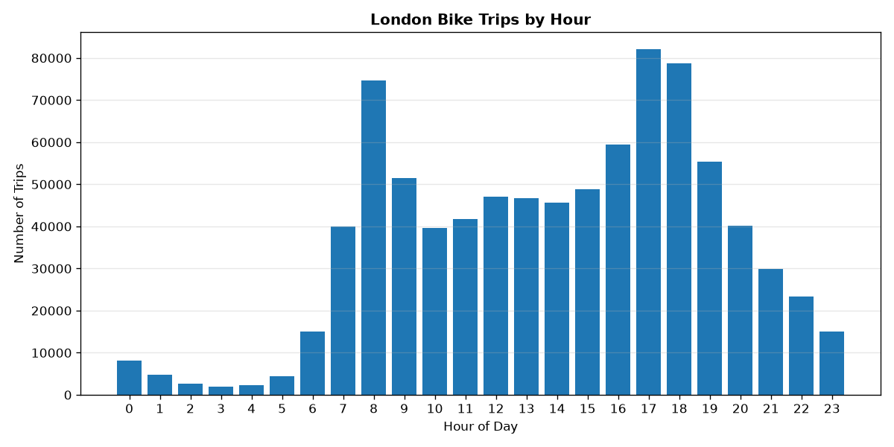
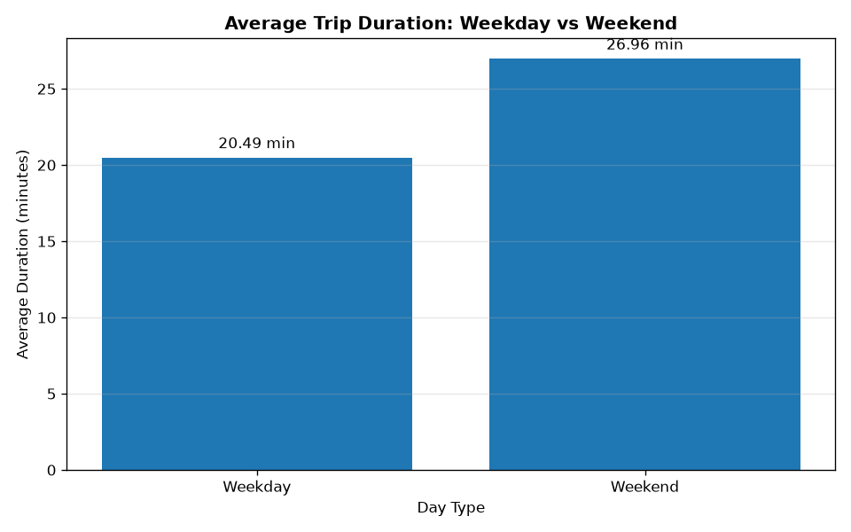
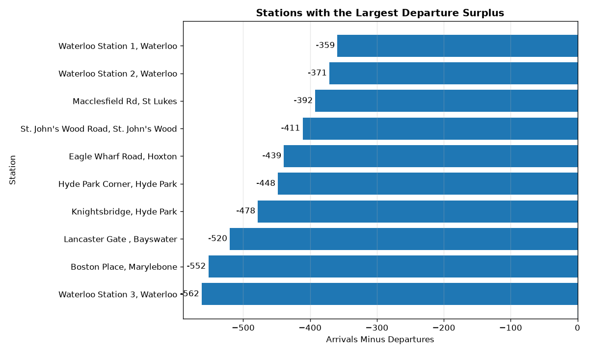
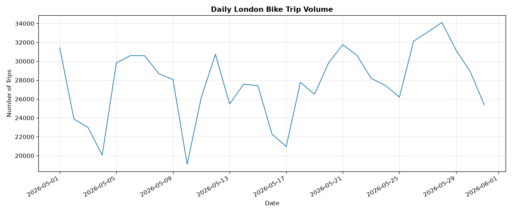
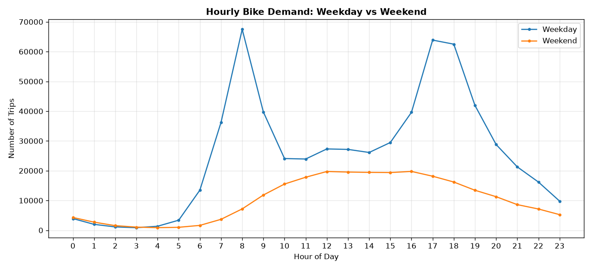
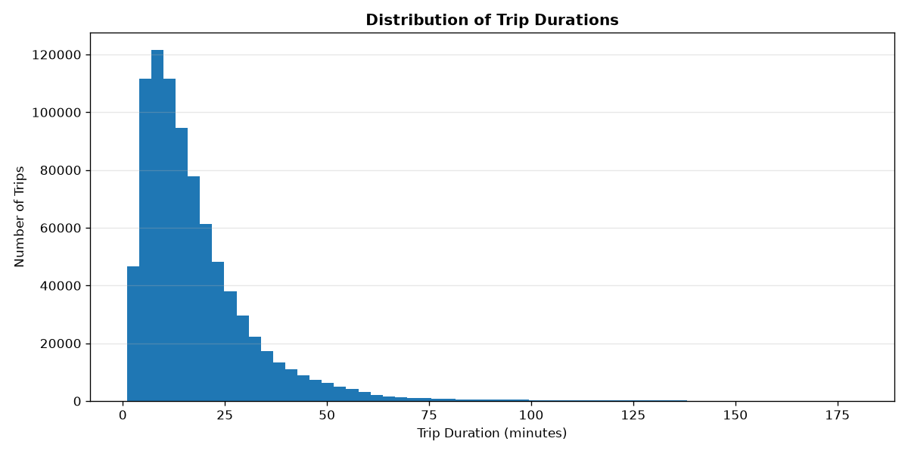
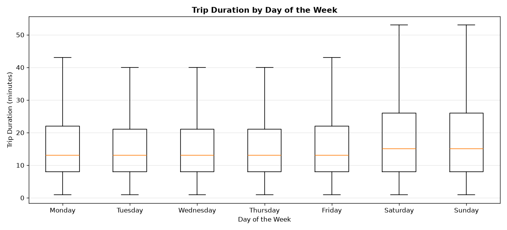
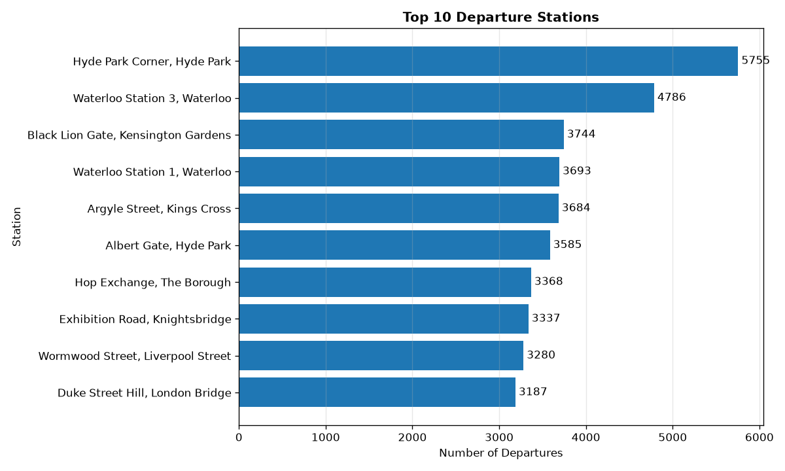
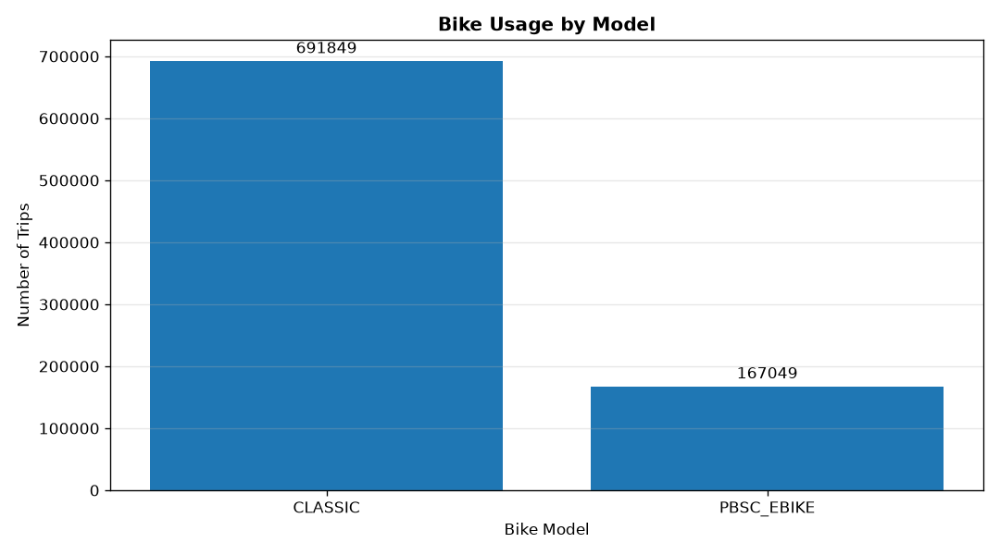
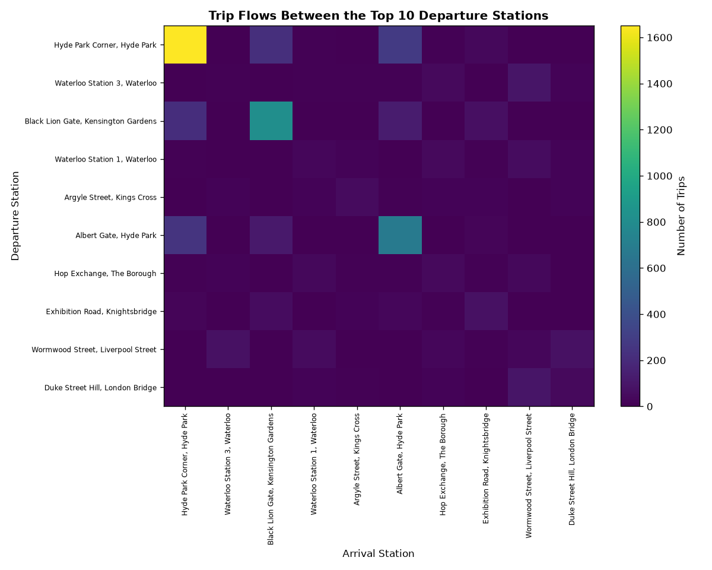

# Business Findings — London Bike Data Platform

## 1. Overview

This report presents the main findings from the analysis of London bike-sharing trip data.

The processed dataset contains **858,898 trips**, retained from 863,017 input records after data cleaning. A total of 4,119 records were rejected because their trip durations were below 60 seconds.

The objective is to identify patterns in trip demand, journey duration, station activity and bike usage, then translate these observations into potential operational improvements.

The findings are descriptive. They identify patterns in the observed dataset but do not establish causation.

### Key Figures

| Metric | Result |
|---|---:|
| Raw records | 863,017 |
| Processed trips | 858,898 |
| Rejected records | 4,119 |
| Rejection rate | Approximately 0.48% |
| Visualisations | 10 |

---

## 2. Hourly Trip Demand

### Observation

The highest observed hourly trip volumes are:

- **5 PM:** 82,026 trips
- **6 PM:** 78,704 trips
- **8 AM:** 74,678 trips

These hours have higher observed trip volumes than other hours in the dataset.

### Interpretation

The morning and late-afternoon peaks are compatible with commuting-related travel patterns. However, the trip records alone do not establish the purpose of individual journeys.

### Business implication

The operator could investigate bicycle availability and operational capacity around these peak hours. Before changing redistribution schedules, the operator should verify whether the pattern persists across comparable days and weeks.

### Limitations

Hourly totals aggregate observations over the available period. They do not establish whether the same pattern occurs consistently every day.

---

## 3. Weekday vs Weekend Trip Duration

### Observation

The average trip duration is:

- **Weekdays:** 20.49 minutes
- **Weekends:** 26.96 minutes

The weekend average is approximately 32% higher than the weekday average.

### Interpretation

Longer weekend journeys may be compatible with more leisure-oriented travel or different journey purposes. However, the dataset does not establish why trips are longer.

### Business implication

The operator could analyse weekend demand separately when evaluating service capacity and bicycle availability. Duration distributions, trip volumes and station activity should also be examined before operational changes are considered.

### Limitations

Average duration does not describe the full distribution of trip lengths. Medians and percentiles would help determine whether the difference applies to typical trips or is influenced by a small number of long journeys.

---

## 4. Station Activity and Net Balance

### Observation

Station activity is compared using arrivals minus departures.

Waterloo Station 3 records:

- **Arrivals:** 4,224
- **Departures:** 4,786
- **Net balance:** -562 trips

A negative balance means that more recorded trips departed from the station than arrived there during the analysed period.

### Interpretation

A persistent departure surplus could indicate greater outbound than inbound trip activity. However, trip counts alone do not establish that the station experiences a shortage of available bicycles.

### Business implication

The operator could investigate stations with sustained departure surpluses by examining their hourly balances, station capacity and actual bicycle availability. These additional data would help determine whether redistribution should be considered.

### Limitations

Net trip balance measures recorded movements over the observation period. It does not measure the number of bicycles physically available at a station at a particular moment.

---

## 5. Daily Trip Volume

### Observation

This time series shows how recorded trip volume varies from day to day.

The final date, 1 June 2026, contains only three recorded trips and is excluded from this visualisation because it appears incomplete.

### Interpretation

Daily variations may reflect differences in travel demand, day of the week, weather, public events or data collection coverage. The current analysis does not establish which factors explain the observed changes.

### Business implication

The operator could monitor daily trip volumes and compare equivalent weekdays across several weeks. This would help distinguish recurring patterns from isolated fluctuations.

### Limitations

Incomplete reporting periods can create misleading declines. Other incomplete dates or missing records should also be investigated before conclusions are drawn about demand trends.

---

## 6. Hourly Demand: Weekdays vs Weekends

### Observation

This chart compares hourly trip counts on weekdays and weekends.

It helps examine whether the distribution of demand throughout the day differs between the two day types.

### Interpretation

Different hourly profiles may be compatible with different travel routines. However, the comparison does not establish the purpose of journeys or explain why demand differs.

### Business implication

The operator could evaluate separate weekday and weekend demand profiles when reviewing operational schedules. Proposed changes should be validated against repeated observations and actual bicycle availability.

### Limitations

The chart compares aggregated counts. Weekdays and weekends may contain different numbers of observed days. Comparing average trips per hour per observed day would provide a more balanced comparison.

---

## 7. Trip Duration Distribution

### Observation

The histogram displays trip durations between 1 and 180 minutes.

Trips longer than 180 minutes are excluded from this visualisation to make the main distribution easier to inspect.

### Interpretation

The distribution can reveal whether trips are concentrated within a particular duration range and whether the data have a long right tail.

### Business implication

The operator could examine duration percentiles and the proportion of long journeys to understand usage patterns and identify areas requiring further investigation.

### Limitations

The histogram does not represent trips longer than 180 minutes. Conclusions about the complete distribution must therefore be based on additional statistics calculated from the full dataset.

---

## 8. Trip Duration by Day of the Week

### Observation

This boxplot compares trip-duration distributions across the seven days of the week.

The visualisation excludes trips longer than 180 minutes and hides individual outlier markers.

### Interpretation

Differences in medians and interquartile ranges may indicate that typical journey durations vary by day. Such differences could be compatible with changes in travel behaviour, but the chart does not establish their causes.

### Business implication

The operator could compare duration distributions by day when investigating weekly usage patterns. These results could complement the analysis of daily demand and station activity.

### Limitations

Trips longer than 180 minutes are excluded, and hidden outlier markers do not mean that those observations have been removed from the underlying dataset.

---

## 9. Top Departure Stations

### Observation

The most frequently used departure stations include:

- **Hyde Park Corner:** 5,755 departures
- **Waterloo Station 3:** 4,786 departures

These figures identify stations with high recorded departure activity in the processed dataset.

### Interpretation

Stations with high departure counts may serve as important origins within the observed network. Departure volume alone does not establish overall station importance, capacity requirements or net bicycle availability.

### Business implication

The operator could investigate the busiest departure stations by comparing departures, arrivals, time-of-day patterns and available bicycle inventory before prioritising operational interventions.

### Limitations

A ranking based on departure counts does not account for station capacity, service disruptions or the distribution of demand throughout the day.

---

## 10. Bike Usage by Model

### Observation

This chart compares the number of recorded trips associated with each bike model.

The model with the highest trip count has the greatest recorded trip volume in this dataset.

### Interpretation

Differences in trip counts may reflect differences in fleet size, availability, model popularity or other factors. The chart alone cannot distinguish between these explanations.

### Business implication

The operator could compare model-level trip counts with fleet size, bicycle availability, trip duration and maintenance records before making fleet allocation decisions.

### Limitations

Trip volume alone does not measure utilisation per bicycle, reliability, operating cost or profitability. Missing or inconsistently labelled model values should also be investigated.

---

## 11. Flows Between Major Stations

### Observation

The heatmap displays recorded trip counts between the ten most popular departure stations, restricted to trips whose arrival station is also in the selected group.

### Interpretation

Large values indicate frequently observed origin-destination pairs within this subset. These may identify recurring connections between busy stations.

### Business implication

The operator could investigate high-volume station pairs and compare their patterns across different times and days. This could inform a more detailed analysis of network demand.

### Limitations

The heatmap does not represent all trips across London. It includes only flows between the selected stations and does not establish whether any route requires additional capacity.

---

## 12. Summary of Potential Operational Actions

The findings suggest several areas for further investigation.

| Finding | Potential action | Additional evidence needed |
|---|---|---|
| High hourly trip volumes | Investigate peak-period bicycle availability | Hourly inventory and repeated daily observations |
| Longer average weekend trips | Compare weekend demand and service requirements | Duration percentiles and daily trip counts |
| Station departure surpluses | Investigate possible redistribution requirements | Station inventory, capacity and hourly balances |
| Daily volume variations | Monitor recurring demand patterns | Completeness checks and comparable weekdays |
| Differences in bike model usage | Compare utilisation across models | Fleet size, maintenance and availability |
| Frequent station-to-station flows | Examine important origin-destination pairs | Broader network coverage and time-specific flows |

These actions are proposals for further investigation, not proven cost savings or confirmed operational requirements.

---

## 13. Data Quality and Analytical Limitations

The analysis has several limitations that should be considered when interpreting the results.

- Trips shorter than 60 seconds are excluded by the current cleaning rules.
- The final date appears incomplete and is excluded from the daily trip visualisation.
- Some charts apply additional filters, such as excluding trips longer than 180 minutes.
- Station balances are calculated from trip counts rather than physical bicycle inventory.
- Repeated trip signatures require further investigation before deduplication.
- Aggregate patterns do not establish the purpose or cause of individual journeys.
- The findings describe the available dataset and should not automatically be generalised to other periods.

---

## 14. Next Steps

Future improvements could include:

- calculating average daily trips by weekday and weekend;
- adding duration medians and percentiles;
- examining station balances by hour and day;
- validating completeness across the entire observation period;
- adding automated tests for analytical queries;
- incorporating weather, calendar or bicycle availability data where available.

These extensions would help determine whether the observed patterns are persistent and operationally meaningful.